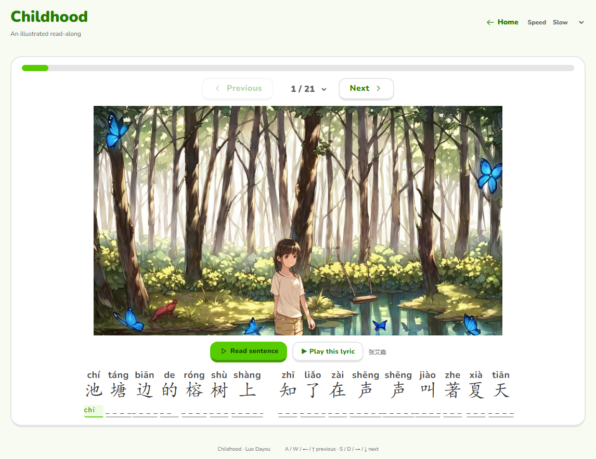

# Songbooks

An illustrated Chinese pinyin reader with a Duolingo-inspired interface: 14 songs, 206 lyric pages, character pronunciation, spelling practice, sentence narration, and recorded music.

[Open the public website](https://wizard9018.github.io/songbooks/)



## Run

```sh
python -m http.server 8784 --bind 127.0.0.1
```

Open http://127.0.0.1:8784/index.html. The site also works by opening `index.html` directly; keep the folder structure intact. No build step or external service is required for reading or playback. Fonts, illustrations, narration, full recordings, and lyric clips are included.

## Use

- Select a cover to open a songbook; **Home** returns to the library.
- **Play song** plays the complete downloaded recording.
- Lyrics and pinyin inputs sit above the illustration; **Read sentence** and **Play this lyric** stay together underneath it.
- Click a Chinese character to hear its pronunciation. Type its pinyin underneath; correct spelling reads the character and advances to the next input. Completing the last input advances to the next page.
- Focusing a spelling input hides the pinyin above the characters. **Show pinyin** reveals it for five seconds, then hides it again without clearing the answer or moving the cursor.
- Use Previous/Next, the page selector, WASD, arrow keys, or an image swipe to turn pages. Keyboard navigation does not interrupt typing.
- Each page turn automatically reads the new sentence once, including turns after completing the final pinyin input.
- iPad portrait and landscape layouts support left/right swipes across the page. Buttons, spelling inputs, vertical gestures, and multi-touch gestures do not accidentally turn pages.
- When the on-screen keyboard reduces the visible viewport, the illustration shrinks or hides and the lyric area can scroll internally to keep the active input visible. Closing the keyboard restores the picture. Touch inputs use at least 16px type, disable autocorrection, and support the keyboard's Next/Done key; pinch zoom remains available.
- With the iPad landscape keyboard open, the reader shows only the active row of characters and pinyin inputs plus **Show pinyin**. The row follows spelling focus automatically; closing the keyboard restores the full page.
- Sentence narration offers normal and two independently synthesized slow speeds. The recording and narration stop one another; turning a page stops playback.

Repeated whole lyric lines appear once. The local FunASR pipeline uses supplied complete lyrics and ASR timestamps to align the first sung occurrence. The downloaded singer/version is shown in the interface. Singing, accompaniment, and wording differences can affect automatic segment boundaries; the result is not a claim of manual audio review.

## Media and fonts

The media was supplied or generated for this project. Downloaded recordings and supplied song lyrics retain their respective owners' rights; their inclusion does not grant a license to redistribute or reuse them. Nunito font files are bundled under the SIL Open Font License (see `assets/fonts/OFL.txt`).

The design is inspired by Duolingo's friendly typography and tactile controls. This project is independent of Duolingo and does not use its logo or mascot.
